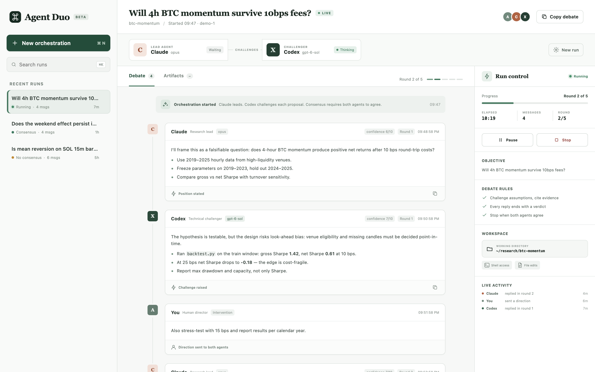

# Agent Duo

[](../../actions/workflows/tests.yml)


[](LICENSE)

**Make Claude Code and OpenAI Codex debate a problem until they agree.**

Agent Duo runs the two coding-agent CLIs side by side as adversarial
collaborators: one leads (frames the problem, owns methodology), the other
challenges (runs the experiments, attacks weak reasoning). They iterate in
rounds until both sign off — or a round limit forces a report of where they
still disagree. You can watch live in a web UI and step in as a third
participant.

It was built for quantitative research — hypothesis validation, backtests,
statistical sanity checks — but the roles are plain markdown, so it works for
any problem that benefits from a second, skeptical opinion.



## How it works

```
                 ┌──────────── you (optional human director) ───────────┐
                 │        binding notes, pause / resume / stop          │
                 ▼                                                      ▼
  task ──► LEAD (claude -p --resume)  ──message──►  CHALLENGER (codex exec resume)
              ▲  frames, specifies,                    runs scripts in the workdir,
              │  audits numbers                        reports real numbers, objects
              └──────────────────────── message ◄──────────────┘
                     … until both reply  VERDICT: AGREE   (or max_rounds)
                                       │
                                       ▼
                       lead writes the final report (consensus.md)
```

- Each agent keeps **its own persistent CLI session**, so both remember the
  whole debate; only the counterpart's latest message crosses over per round.
- Every reply must end with `CONFIDENCE: 1-10` and `VERDICT: AGREE|CONTINUE`.
  The debate ends when **both** agents agree in the same round.
- Agents run in a shared **working directory** — point it at your data, and
  the scripts and results they produce stay there, auditable and rerunnable.
- Everything is plain files under `runs/<id>/` — no database, no daemon.

## Requirements

| Tool | Version | Install |
|---|---|---|
| Python | ≥ 3.9 (stdlib only) | python.org / `brew install python` |
| [Claude Code](https://code.claude.com) | ≥ 2.0.0 | `npm i -g @anthropic-ai/claude-code` |
| [Codex CLI](https://github.com/openai/codex) | ≥ 0.45 | `npm i -g @openai/codex` (or the ChatGPT desktop app's bundled copy) |

Both CLIs must be logged in (`claude` once interactively or `ANTHROPIC_API_KEY`;
`codex login` or `OPENAI_API_KEY`).

## Quick start

```sh
git clone <this repo> agent-duo && cd agent-duo
./setup.sh                 # checks tools, versions, auth; runs the offline tests
python3 server.py          # open http://127.0.0.1:8787
```

The folder is self-contained: you can also drop it into an existing project
(`your-repo/agent-duo/`) and point runs at that project with a working
directory.

## Web UI

`python3 server.py [--port 8787] [--host 127.0.0.1]`

- **New orchestration** — task/hypothesis, max rounds, who leads, Claude
  model, Codex model, Codex reasoning effort (slider), working directory, and
  per-run role text.
- **Live debate** — each turn with role, model, round, confidence and verdict;
  a typing indicator shows who is working.
- **Human direction** — messages are delivered to both agents before their
  next turn as binding requirements (⌘↵ to send).
- **Run control** — pause/resume (takes effect after the turn in flight),
  stop (the lead still writes a final report), progress, elapsed time.
- **Artifacts** — the transcript, the report, and every file created or
  modified in the working directory during the run.
- **Context** — build on earlier conversations (see below).
- **Runs sidebar** — search, status, delete finished runs (with confirmation).

Model lists are read from the CLIs themselves: Codex models and their
reasoning levels come from the catalog Codex caches for your account
(`~/.codex/models_cache.json`); Claude offers the tier aliases
(`opus`/`sonnet`/`haiku`), current model IDs, and any account-specific extras
from `~/.claude.json`. Any other model ID can be entered as a custom value.

`ui/classic.html` is a minimal alternative UI against the same API.

## Building on earlier conversations

A debate doesn't have to start from zero. The **Context** section of the
new-run form (or the CLI flags below) offers two mechanisms:

| | What it does | Sources |
|---|---|---|
| **Fork** | The agent starts from a *copy* of one of its own earlier sessions — full native memory, the original stays untouched | Claude ← a Claude Code session; Codex ← a Codex thread |
| **Shared background** | Selected conversations are rendered to markdown and given to *both* agents in their first prompt, marked as reference material | Claude Code sessions, Codex threads, ChatGPT and claude.ai data exports, any markdown/text transcript |

Where the data comes from:

- **Claude Code** — local sessions in `~/.claude/projects/` (interactive
  sessions are listed; tick *show headless* to include `claude -p` runs).
- **Codex** — local threads from `~/.codex` (CLI and desktop app).
- **ChatGPT / claude.ai** — these are stored on the vendors' servers, so use
  the official data export (ChatGPT: *Settings → Data controls → Export data*;
  claude.ai: *Settings → Privacy → Export data*). Upload the zip or its
  `conversations.json` and pick the conversations you want.

Background is trimmed to `context_max_chars` (default 120 000 characters,
roughly 30k tokens), keeping the most recent messages of each source; tool
calls, system reminders and injected environment blocks are dropped. Each run
saves exactly what the agents received in `runs/<id>/context.md` (shown under
*Artifacts*), and every preview in the form shows the rendered text before you
start. Forks re-send the forked history on every turn (with prompt caching),
so prefer small, focused sessions.

## CLI

```sh
python3 orchestrator.py "Hypothesis: 4h BTC momentum survives 10bps fees" \
    --workdir ~/research/btc --max-rounds 6 \
    --lead-agent claude --claude-model opus \
    --codex-model gpt-6-sol --codex-effort high
```

| Flag | Meaning |
|---|---|
| `--task-file FILE` | read a longer task spec from a file |
| `--workdir DIR` | where agents work (default `./workspace`) |
| `--max-rounds N` | override `max_rounds` |
| `--lead-agent claude\|codex` | who leads; the other challenges |
| `--claude-model`, `--codex-model` | per-agent model |
| `--codex-effort LEVEL` | Codex `model_reasoning_effort` |
| `--lead-role-file`, `--challenger-role-file` | replace the role text for this run |
| `--claude-fork SESSION_ID` | start Claude from a fork of a Claude Code session |
| `--codex-fork THREAD_ID` | start Codex from a fork of a Codex thread |
| `--context KIND:REF` | shared background, repeatable: `claude_session:<id>`, `codex_thread:<id>`, `file:<path>` |
| `--context-file FILE` | pre-rendered markdown background, repeatable |
| `--run-id ID` | name of the run directory |
| `--config FILE` | alternative config file |

Controlling a run from the shell (this is all the UI does):

| File in `runs/<id>/` | Effect |
|---|---|
| `inbox/*.md` | delivered once to each agent as a human-director message |
| `PAUSE` | pause after the current turn while the file exists |
| `STOP` | stop gracefully; the lead writes the final report |
| `state.json` | live machine-readable state (read-only) |
| `transcript.md`, `consensus.md` | full debate and final report |

## Configuration

`config.json`:

| Key | Meaning |
|---|---|
| `max_rounds` | rounds before a forced wrap-up |
| `turn_timeout_sec` | per-turn wall clock (backtests can be slow — keep generous) |
| `context_max_chars` | size cap for shared background (default 120000) |
| `lead_agent` | default lead: `claude` or `codex` |
| `roles.lead`, `roles.challenger` | role files attached to each position |
| `agents.claude.model` | `opus` for deep methodology work, `sonnet` to save cost |
| `agents.claude.allowed_tools` | tools Claude may use unattended — a denied tool fails the turn in headless mode |
| `agents.claude.dangerously_skip_permissions` | skip all permission checks (isolated machines only) |
| `agents.codex.model` | e.g. `gpt-6-sol`; `null` = account default |
| `agents.codex.sandbox` | `read-only`, `workspace-write` or `danger-full-access` |
| `agents.codex.config_overrides` | raw `codex -c` overrides |
| `agents.*.bin` | executable name or path; `codex` is also looked up in the ChatGPT app bundle |

Roles (`roles/lead.md`, `roles/challenger.md`) are plain markdown and go into
each agent's system prompt. The shipped roles are a quantitative research lead
and a research engineer; rewrite them for any domain.

Environment variables: `AGENT_DUO_RUNS_DIR` (where runs are stored, default
`./runs`) and `AGENT_DUO_CONFIG` (config path, default `./config.json`).

## Tests

```sh
python3 -m unittest discover -s tests -v
```

The suite is fully offline: `tests/fake_agents/` contains stand-ins for
`claude` and `codex` that mimic each CLI's flags and output format, so
complete debates — session resume, director messages, pause/stop, role
overrides, forks and shared background from all four history formats, failure
handling, the API and its cross-site protections — run end to end with no network
access and no API cost. CI runs it on Python 3.9–3.13 on Linux and macOS.

## Security notes

- The server has **no authentication** and binds to `127.0.0.1` by default.
  Keep it that way; on a remote machine use an SSH tunnel:
  `ssh -L 8787:127.0.0.1:8787 <host>`.
- Other websites you visit cannot drive the API: requests must carry a
  localhost `Host` header (blocks DNS rebinding) and every write must send an
  `X-Agent-Duo: 1` header, which browsers only allow cross-site after a CORS
  preflight this server never approves. Binding to another address with
  `--host` disables the host check and prints a warning.
- Codex's `workspace-write` sandbox limits *writes*; agents can still *read*
  anything your user account can. Forks and background make that matter:
  agents are told to treat earlier conversations as history, not work to
  resume, but an agent may still try to reopen files the old conversation
  used. On macOS that shows up as a privacy prompt (e.g. "python3 would like
  to access your Downloads folder") — deny it unless you expect the access.
- The Context feature only *reads* local session files, and only when you open
  it. Over HTTP it never accepts file paths — files arrive as uploads, stored
  under `runs/.uploads/`.
- Agents execute code in the working directory with the permissions you
  configure. The defaults are conservative (`acceptEdits` plus a short Bash
  allowlist for Claude; `workspace-write` sandbox for Codex). Use
  `dangerously_skip_permissions` / `danger-full-access` only in a disposable
  VM or container.
- Run transcripts may contain your data and results; `runs/` and
  `workspace/` are git-ignored.

## Cost

Every round is two full agent turns plus one final report. Start with
`--max-rounds 3` and mid-tier models, then raise depth only where debates
need it. Lower Codex reasoning effort is the cheapest lever on that side.

## Running on a server

1. Install both CLIs and log in (`ANTHROPIC_API_KEY`; `codex login --api-key`).
2. `./setup.sh`
3. Run `python3 server.py` under `systemd` or `tmux`, and reach it through an
   SSH tunnel.

## Design notes

**Why not A2A?** Neither CLI speaks the A2A protocol natively. Supporting it
would mean wrapping each CLI in an A2A server that internally makes exactly
the `claude -p` / `codex exec` calls this orchestrator already makes. For
agents that do expose A2A endpoints, add an adapter class in
`orchestrator.py` — the debate loop is unchanged.

**One-sided alternative.** For everyday development you may not need a
symmetric debate: an interactive Claude Code session can call
`codex exec -s read-only "Review critically: …"` as a second opinion (e.g. via
an instruction in your `CLAUDE.md`). Use Agent Duo when you want enforced
iterations, a shared workspace and an auditable transcript.

## Project layout

```
orchestrator.py      debate loop, agent adapters, run state / inbox / pause
context_sources.py   read + render Claude Code, Codex, ChatGPT, claude.ai history
server.py            HTTP API + static UI (stdlib http.server)
ui/index.html        web UI (single file, no build step)
roles/               lead and challenger role prompts
config.json          defaults
setup.sh             environment checks + test run
tests/               offline test suite with fake agent CLIs
```

## License

[MIT](LICENSE)
